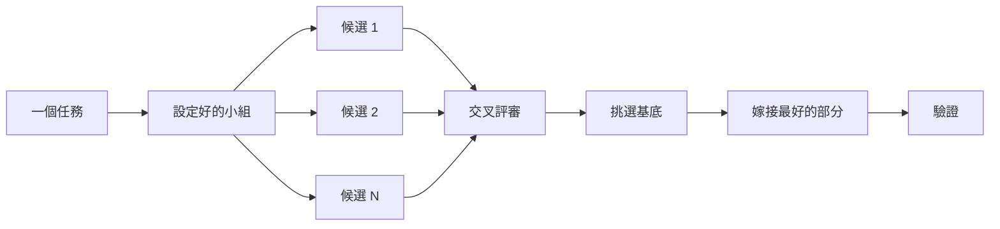

# 寫程式之前先設計

對一個困難的設計只嘗試一次，就會鎖定模型最先想到的形狀。`/architect` 在實作前先定好型別和邊界。`/arena` 對同一份需求做好幾次嘗試，再合併最好的部分。`/interrogate` 讓其他模型試著把結果弄壞。當工作重點是「涵蓋範圍」而不是「綜合設計」時，`/swarm` 會把區塊或競賽分散出去，再彙整結果。

最常見的兩種設計錯誤是：直接採用 agent 的第一個設計，以及一直打磨一份沒有任何程式碼驗證過的計畫。這一頁解決這兩個問題。你要**透過程式碼來規劃**：用原型回答未解的問題，用 README 或教學文件設定目標，書面計畫放在最後。


## 用 `/architect` 定下形狀

```text
/architect 寫任何程式碼之前，先設計匯入流程。我最在意的是呼叫端怎麼使用它。
```

[`/architect`](../../skills/architect/SKILL.md) 會先打好基礎：對設計涉及的程式碼跑 `/how`，如果會移動所有權或層級就再跑 `/why`。接著它跑 `/arena` 產生多個互相競爭的設計草稿，每個草稿都**先寫呼叫端的用法**，再寫型別、函式簽名和模組地圖。

預設情況下，它會從綜合出的設計直接進入實作。如果你想先看設計，就明講：

```text
/architect 加檢查點。實作前先停下來給我看。
```

程式開始寫之後，設計就不是神聖不可侵犯的。如果實作時在不相關的地方出現同樣的繞路寫法，或型別只能靠 `any` 或強制轉型才能編譯，`/architect` 會把這當作設計錯誤的證據。它會丟掉草稿重新來過，而不是繞著問題修補。

## 用 `/arena` 分散嘗試

```text
/arena 把我的提示詞原封不動送進競技場。我想比較它們的提案和你的。
```

[`/arena`](../../skills/arena/SKILL.md) 是底層的通用工具。N 個子代理平行嘗試同一份設計或程式需求，各自寫在自己的 worktree 或資料夾裡。一個來自**不同模型家族**的唯讀評審依照評分標準替每個候選打分數。如果沒有其他家族的模型可用，協調者會跳過評審，自己挑基底。協調者會從頭到尾讀完每個候選，挑一個當基底，把落選者最好的點子嫁接進來，然後驗證結果。



小組成員來自你的 [`/setup-pstack`](../../skills/setup-pstack/SKILL.md) 設定，每個任務都可以調整。決定很重要時要求更多候選，不重要時就少一點：

```text
/arena 處理這個，5 個候選。快取鍵的格式之後很難改。
```

## 用 `/swarm` 涵蓋各區塊與競賽

```text
/swarm 用每個套件自己的 check.sh 檢查 packages/ 底下所有套件。每個套件一個 worker，最後一份報告。
```

[`/swarm`](../../skills/swarm/SKILL.md) 把 N 個 worker 分散到彼此獨立的區塊、涵蓋矩陣、關卡賽道、探索分區，或事先宣告的競賽組別。每個 worker 有自己的範圍和檢查，回報 `PASS`（通過）、`ISSUES`（有問題）或 `BLOCKED`（卡住）。主代理會等所有 worker 完成，再交回一份精簡報告，列出任何缺口或掉隊者。

當平行化能換來涵蓋範圍、或能讓獨立的檢查互相競賽時就用它。`/arena` 給每個 worker **同一份**設計或程式需求，再挑基底、嫁接最好的部分。`/swarm` 則是涵蓋不同區塊，或依照事先宣告的選擇規則跑競賽，不走挑基底和嫁接的流程。

## 用 `/interrogate` 試著弄壞它

```text
/interrogate 審查整個分支，但要抱持懷疑。除非是真正的 bug 或退步，否則不要挑小毛病。
```

[`/interrogate`](../../skills/interrogate/SKILL.md) 把變更和它的意圖交給設定好的模型扮演的「對手」，每個對手都會對真實程式碼實際執行，試著把它弄壞。不同對手會找到不同的失敗。只有重新執行指令後仍顯示「違反意圖的失敗」，那個發現才會留下。報告會列出每個經驗證的發現以及找到它的對手，接著列出每個對手放棄了什麼、為什麼，而且**不會套用任何修改**。

也要讀「被放棄（Dropped）」的清單。你可以推翻它的判定。

## 用原型取代爭論

永遠不要採用第一個設計。要求好幾個，再根據你看得到的證據挑選：

```text
/poteto-mode 為新的下拉選單做幾個原型選項。截圖或錄影給我比較。
```

[原型劇本](../../skills/poteto-mode/playbooks/prototype.md) 會在暫存資料夾做出用完即丟的草稿，把所有變體放在同一個切換器後面，實際操作每一個，並擷取截圖或計時。它也適用於行為和演算法，不只是 UI。原型就是**用程式碼做規劃**。它讓 agent 能透過實際執行來回答自己的疑問，而不是來問你；也留了空間給你自己想不到的選項。

同樣的概念可以擴大到真正的設計。把 `/architect` 和原型搭配，並保留一個審查關卡：

```text
/poteto-mode 我們需要對外部 webhook 做流量限制。先用 /architect 設計，未解的問題用原型回答。繼續之前讓我審查。
```

不要把「對手」浪費在抽象的計畫上。`/interrogate` 會放棄所有無法用實際執行證明的發現，所以一份沒有程式碼的計畫，對手幾乎沒東西可以弄壞。先讓原型解決問題，再審查做出來的東西。

## 共用程式碼要先寫 README

對於其他程式會使用的套件或 API，先寫使用者會讀的文件：

```text
/poteto-mode 先寫一份教學，說明我會怎麼使用新的設定套件。然後用 /teach 教我它為什麼比現在的好。
```

先寫教學會逼你站在呼叫端的角度。你向一個假想的使用者描述 API，再倒推回實作。這份文件也會變成一個具體的目標，讓 agent 用來檢查自己的成果。當文件本身很重要時，點名 [`/technical-writing`](../../skills/technical-writing/SKILL.md)，這樣教學就會維持是教學，不會同時變成參考手冊又變成概念解說。

## 設計定下來之後再規劃

pstack **刻意**沒有規劃技能。如果你真的想要書面計畫，等設計定下來再要：

```text
/poteto-mode 把這個設計轉成計畫。拆成小而可驗證的 PR，每個都有自己的驗證步驟。
```

[多階段計畫劇本](../../skills/poteto-mode/playbooks/multi-phase-plan.md) 會先用原型解決剩下的問題，再為每個 PR 寫一節，每節都以「證明這個改動有效」作結。光是測試全部通過**不算**這種證明。計畫本身就是交付物。這個劇本不會去實作它，但會指出接下來該由哪個執行劇本來跑。

做遷移時，在提示詞裡說明標準：

```text
/poteto-mode 規劃把我們的 UI 函式庫遷移到新的樣式系統。拆成小而可驗證的 PR，每個都要有視覺回歸檢查。結果必須跟原本一模一樣，連 bug 也一樣。
```

「連 bug 也一樣」可以避免遷移過程中悄悄修掉東西，否則新舊輸出就無法比對了。對於跨越很多天的專案，你可以暫時把計畫提交進 repo，讓其他 agent 看到進行中的工作；工作完成後再刪掉。

## 一個任務值得多少設計工作？

你可能在想是不是每個改動都需要這些。不是。**大多數改動完全不需要。** 一個大致的階梯：

- 一個已完成、但你不太放心的小改動：只要 `/interrogate`。
- 跨越函式邊界或移動所有權的改動：值得用 `/architect`，它會順便帶上 `/arena`。
- 一個獨立的決定，多次獨立嘗試會有幫助的，例如命名、格式或演算法：直接用 `/arena`。
- 涵蓋矩陣、一組平行檢查、或有宣告組別的競賽：用 `/swarm`。
- 可以透過實際執行來回答的問題，例如版面、時間、做法：做原型，不要爭論。
- 有爭議、而且很難回頭的設計：先 `/architect`，出貨前再 `/interrogate`。
- 跨好幾個 PR 的工作：做計畫，但要在設計定下來之後才寫。

`/poteto-mode` 已經會套用這個階梯。跨越邊界的工作會自動觸發 `/architect`，所以你主要是在想要比預設**更多或更少**檢查時，才直接呼叫這些技能。

下一頁：[建構並清理變更](./05-build-and-clean.md)。
