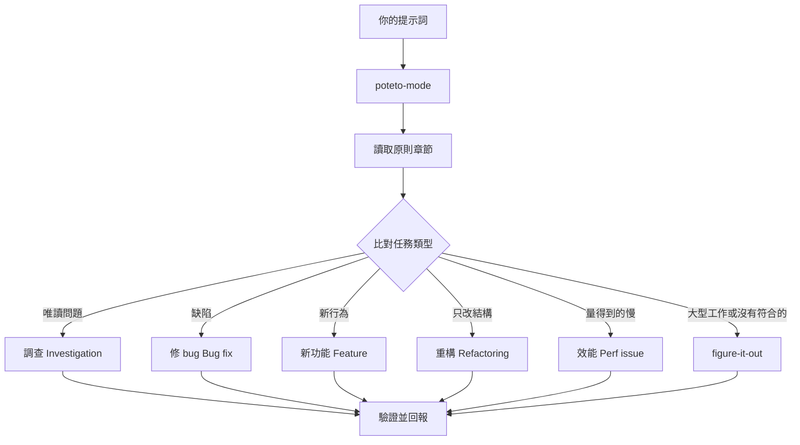

# 透過 `/poteto-mode` 分派工作

`/poteto-mode` 是正門。你給它一個目標，它從二十三個劇本中挑一個，把該劇本的步驟複製到待辦清單，並在步驟需要時呼叫其他技能。這一頁教你好的提示詞長什麼樣子，以及你其實只需要寫多少。


## 你的提示詞會經歷什麼



上圖是常見路線。另外還有這些劇本：爬坡優化某個指標、診斷執行期症狀與擷取的追蹤檔、原型、視覺一致、撰寫與評測技能、自主執行、開 PR、看顧 PR 或 PR 串到可合併、出貨已驗證的 PR 串、以自動駕駛處理 PR 佇列或 PR 串、統籌專案規模的計畫、接手工作、安全暫停、多階段計畫、清理 worktree。[劇本資料夾](../../../pstack/skills/poteto-mode/playbooks/) 裡有完整清單。

## 說目標，不要說儀式

你不用寫規格書。說出哪裡有問題或你想要什麼，再加上任何你已經知道、能幫 agent 省時間的資訊：

```text
/poteto-mode 重試之後使用者會收到兩則通知。先重現，再修好並驗證。
```

這是一個「修 bug」提示詞。「先重現」是真正的限制條件，不是客套話，劇本會遵守它。注意看待辦清單被填入修 bug 的步驟。被跳過的步驟會以 `skip: <原因>` 的形式留著。

## 提示詞裡該放什麼

一個好用的提示詞最多包含五件事，每件一句話就夠：

- **目標。** 說出哪裡壞了，或你想要什麼。
- **完成的檢查方式。** 必須能判斷「通過」或「失敗」。「讓它更好」、「做一個小時」都不算檢查。
- **你想看到的證據。** 要求真實的指令輸出、操作流程的影片、存進去的數值，或前後對照的數字。
- **你已經知道的事。** 症狀、重現步驟、一行 log 或一個連結，可以幫 agent 省下搜尋時間。
- **真正的限制。** 「先重現」、「先不要改任何程式碼」、「行為零改變」、「繼續之前讓我審查」，每一句都會改變 agent 的行為。

一個五項都有的提示詞：

```text
/poteto-mode 從昨天部署之後，CSV 匯出會掉最後一列。失敗的工作 ID 是 4812。先重現，再修。完成的定義是：6 萬列的測試資料每一列都有匯出。給我看修正前後的列數。
```

有兩樣東西最好**不要**寫：

- **怎麼做。** 說要達成什麼，留空間讓 agent 找到比你想的更好的路。列出技能清單也一樣，見下方的陷阱說明。
- **一開始先別說你對原因的猜測。** 一說出猜測，搜尋就會被縮小到你指的地方。先讓 agent 複述問題，再分享你的直覺。

面對雜亂的回報（例如一長串討論串或模糊的 bug），把「複述」設為第一步：

```text
/poteto-mode 讀這串討論。用你自己的話、用白話複述根本問題。先不要改任何程式碼。
```

誤解會在複述時就浮現，在任何程式碼出現之前。在那時糾正，只花你一則訊息，而不是一次錯誤的修正。如果只想要複述、不走劇本，就用 [`/in-your-own-words`](../../../pstack/skills/in-your-own-words/SKILL.md)，它會複述 agent 認為你的目標是什麼、你想解決什麼問題。

不確定提示詞方向對不對時，送出前先用 [`/sharpen`](../../../pstack/skills/sharpen/SKILL.md)：

```text
/sharpen 寫一份 v2 設定格式的遷移指南。
```

agent 會告訴你：頂尖專家會做哪些你沒要求的事、他們會從什麼最原始的材料開始、會用什麼方法和工具，以及除了你和 agent 之外，有什麼能證明結果是對的。然後它把你的提示詞改寫成正好要求這些——更深但不更長——並保留你的選擇空間。它**不會**做任務本身。讀完改寫的版本，再送出，例如搭配 `/poteto-mode`。

## 追問可以很短

當對話已經有足夠的脈絡，提示詞可以短到幾乎沒有。以下都夠用：

```text
/poteto-mode 做吧
```

```text
繼續
```

```text
一直做到完成
```

短也行，是因為劇本掌握了結構，而自訂模式（Custom Mode）讓 `/poteto-mode` 每一輪都留在上下文裡。[設定 pstack](./01-setup.md#跑你的第一個任務) 有教怎麼開啟。你的話傳達意圖，技能負責嚴謹。

## 用「新任務」切換任務

長聊天會累積上一個任務的脈絡。換主題時，要明講：

```text
/poteto-mode 新任務。找出為什麼登出後快取資料還在。先不要改任何程式碼。
```

「新任務」告訴 `/poteto-mode` 重新比對劇本，而不是繼續上一個劇本。「先不要改任何程式碼」會把這次釘在「調查」劇本。少了這兩句，一個正在做新功能的模式，往往會把你的問題當成新功能的下一步。

## 平行工作要給它自己的機器

如果你在同一台電腦、同一個 repo 上跑好幾個 agent，它們會搶工作目錄、搶連接埠、搶建置輸出。最乾淨的隔離方式是[雲端子代理](https://cursor.com/docs/subagents#cloud-subagents)：每個都有自己的虛擬機和分支，可以安裝相依套件、執行你的 app、錄下結果影片，完全不碰你的電腦。在任務前輸入 `/in-cloud`，或請主聊天把工作交給雲端子代理。

如果工作必須留在本機，一開始就要求用 worktree：

```text
/poteto-mode 新任務。從 <base> 開一個新的 worktree 分支，然後把解析器的修改移植過去。
```

每個任務都有自己的分支和 worktree，就沒有 agent 會踩到別人的檔案。worktree 會佔磁碟和電腦資源，所以一台筆電同時只能跑幾個。[開 PR 劇本](../../../pstack/skills/poteto-mode/playbooks/opening-a-pr.md) 本來就會在 worktree 裡處理程式碼修改，所以通常只有在特定的基底分支或位置很重要時，你才需要特別說。

worktree 會越積越多。磁碟快滿時，問：

```text
/poteto-mode 是什麼吃掉了我的磁碟？把可以安全刪除的 worktree 清掉。
```

[清理 worktree 劇本](../../../pstack/skills/poteto-mode/playbooks/worktree-cleanup.md) 會依合併狀態、未提交的修改、以及哪些聊天還在使用，把每個 worktree 分類。它只刪除證據顯示可以刪的，遇到有未提交修改的會停下來讓你決定。

## 讓它自己跑

要離開時，說清楚「完成」是什麼意思，然後就走：

```text
/poteto-mode 我要離開一下。一直做到遷移檢查回報舊呼叫端為零為止。把你的決策記錄下來。
```

這種你之後才會審查的工作，會經過 [`/figure-it-out`](../../../pstack/skills/figure-it-out/SKILL.md)，它會設計執行的各個階段，並維護一份 [`/show-me-your-work`](../../../pstack/skills/show-me-your-work/SKILL.md) 決策紀錄。[讓工作在你睡覺時進行](./07-overnight.md) 會完整說明整夜合約。

**陷阱：** 不要在提示詞裡列出技能（「先用 /how，再用 /architect，再用 /arena……」）。劇本已經安排好順序，你手寫的順序通常會打亂或漏掉劇本本來會保留的步驟。只有當你想覆寫某個特定選擇時，才點名技能。

完整的路由規則請讀 [`poteto-mode`](../../../pstack/skills/poteto-mode/SKILL.md) 本身。

下一頁：[理解程式碼](./03-understand.md)。
