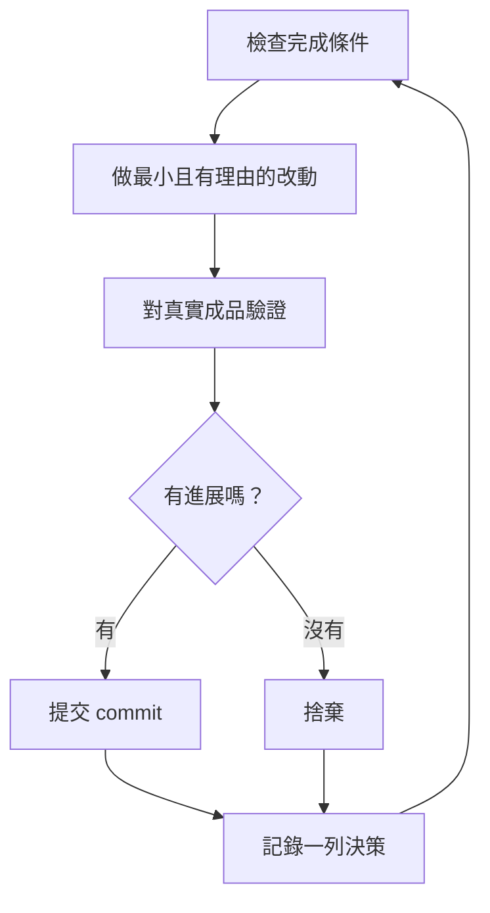

# 讓工作在你睡覺時進行

這是前面所有努力的回報。一個你能信任它會自我驗證的 agent，就是一個你可以讓它獨自處理困難任務的 agent。讓這件事安全的不是希望，而是：一個可以檢查的完成條件、一個隔離的 worktree 或雲端 agent，以及一份你早上起來稽核的決策紀錄。


## 先贏得信任，再跑迴圈

一個你不信任的迴圈，只會更快地產出未經檢查的工作，而且每多跑一輪，爛攤子就疊得更高。在讓它自己跑之前，先確認它值得信任：

- 你親手做過一次這個任務，或看過 agent 做一次，所以你知道「好」長什麼樣子。
- agent 擁有你自己會用的工具和訊號：驗證技能、效能分析工具、log。
- 每個階段都會證明自己的成果，並能在成果不達標時讓整條產線停下來。
- 你讀過幾份對話紀錄，並把重複出現的失敗變成工具、技能或檢查。

四項都成立後，才讓迴圈自主運作。在那之前，在你看著的時候跑。

## 整夜合約

一份好的交接包含：目標、完成條件、權限，和一個逃生口。不需要很長：

```text
/poteto-mode 我要去睡了。在一個從 <base> 開出的新 worktree 裡，把每個呼叫端遷移到新的解析器。
完成的定義：舊呼叫端為零、所有解析器測試資料都通過、舊 API 已刪除。
保留決策紀錄。提交前不用問我。
/loop 直到完成。如果過了幾個小時真的卡住了，就停下來寫明原因。
```

逐行看看每一句換來什麼：

- 「我要去睡了」是一個工作階段層級的覆寫指令。agent 不再發問，持續做下去。
- 「完成的定義……」把目標變成每一輪都能執行的檢查。
- 「從 `<base>` 開出的新 worktree」讓這次執行不會跟你開著的其他東西衝突。
- 「提交前不用問我」預先回答了 agent 原本會卡住等你的權限問題。
- `/loop` 是 Cursor 內建的喚醒機制，不是 pstack 的技能。[自主執行劇本](../../../pstack/skills/poteto-mode/playbooks/autonomous-run.md) 用它在事件發生時或定時心跳時重新檢查完成條件。
- 逃生口讓它在真正走進死胡同時停下來並寫明原因，這遠勝過八個小時「創意地重新詮釋目標」。

因為這種工作你會在離開後才審查，`/poteto-mode` 會把它導向 [`/figure-it-out`](../../../pstack/skills/figure-it-out/SKILL.md)，在寫任何程式碼之前先設計各個執行階段，並接上決策紀錄。

想刻意停止一次執行，就告訴 agent 暫停，或告訴它你要離線或要重開 Cursor。[安全暫停劇本](../../../pstack/skills/poteto-mode/playbooks/pause-safely.md) 會完成或退出目前的步驟、提交一個「進行中」的檢查點，並寫一份接續說明。新的聊天可以透過「接手工作」劇本從那份說明繼續。說「繼續」**永遠不會**觸發暫停。

## 迴圈整晚在做什麼



每一輪：一個改動、一次檢查、一列紀錄。沒有幫助的改動會被捨棄，不會被留著順便帶過。遇到停滯代表要**轉向**，不是停止；而完成條件永遠不會被悄悄放寬來宣告勝利。

## 早上的稽核

[`/show-me-your-work`](../../../pstack/skills/show-me-your-work/SKILL.md) 讓這次執行變得可以審查。每一列記錄時間、階段、決策、理由、證據指標和結果，存在 `decisions.tsv` 這個 TSV 檔（如果好幾次執行共用一個資料夾，則是 `.audit/<task-slug>.tsv`）。預設只存在本機。當工作夠有野心、審查者需要這份紀錄才能信任結果時，就把它提交進去。

回來之後，要求以審查的形式呈現這次執行：

```text
/show-me-your-work 告訴我你昨晚做了什麼
```

在交回摘要之前，這個技能會派一個**不同模型家族**的審查者去讀紀錄和對話紀錄，回覆最後會有一個 Attention（注意）章節，列出值得你仔細看的地方。先讀那個章節，再讀它指向的紀錄列。你要稽核的是**決策**，不是重讀整個晚上。

如果你只想快速了解狀態而不是稽核，在執行工作的那個聊天裡跑 [`/ketchup`](../../../pstack/skills/ketchup/SKILL.md)。它只讀不改，用白話告訴你從你上一則訊息之後改變了什麼，並附上工作中產生的截圖和小圖。接著它列出每一件等你決定的事，例如合併、核准、或在幾個選項中做選擇，附上它的建議、證據和風險，讓你光看回覆就能決定。

## 當夜裡要處理的是一個佇列，而不是一個任務

上面的合約是把一個任務推到一個完成條件。有些晚上要處理更多：一整個佇列的獨立改動，或一整個計畫。有三個劇本把同樣的信任機制擴大。

[全自動駕駛（Autopilot-full）](../../../pstack/skills/poteto-mode/playbooks/autopilot-full.md) 把一個佇列的獨立 PR 一路做到合併。每個 PR 有一個負責的 agent，從建構一路帶到合併，而且沒有任何負責人能憑自己的判定就合併。一群全新的驗證者會檢查負責人「程式就緒」的版本。之後的 rebase 或小修正會由一個全新的驗證者檢查，只有新的行為或大量新的 diff 才會再叫出整群驗證者。只有對「最後要合併的那份修改」給出乾淨的判定，才能授權合併：

```text
/poteto-mode 對這個佇列開全自動駕駛。每一項都是獨立的。我希望明早全部合併。
```

[自動駕駛不合併版（Autopilot-stack）](../../../pstack/skills/poteto-mode/playbooks/autopilot-stack.md) 就是不做合併的全自動駕駛。你醒來時會看到已驗證的 PR，每個都附上判定，由你自己審查和合併。只有當一個 PR 真的建立在另一個 PR 之上時，才會疊在它上面。當你希望在任何東西合併前都親眼看過時，選它而不是全自動駕駛：

```text
/poteto-mode 用自動駕駛處理這五個改動，但不要合併。我早上自己來合併。
```

[統籌（Orchestrate）](../../../pstack/skills/poteto-mode/playbooks/orchestrate.md) 用在比任何單一 agent 都活得更久的計畫：跨多天、很多堆疊 PR、一大群子代理，由一個常駐的協調者聊天視窗統管。協調者決定每塊工作由哪個 agent 做、檢查每個 agent 的產出，而且自己**從不**寫程式。如果一個 agent 在一個工作階段內就能做完，這個劇本會自己把你導回上面的整夜合約：

```text
/poteto-mode 統籌 store 的遷移。負責到底，直到每個套件都轉換並合併為止。我一天會來看兩次。
```

## 平行跑多個專案

[Cursor Project](https://cursor.com/blog/projects) 給一個協調者 agent 一條持續存在的對話串。協調者不寫程式，它指揮子代理；子代理預設在雲端執行，所以你把筆電闔上工作也會繼續。這正是統籌劇本預期的形態。對協調者下的提示詞以 `/poteto-mode` 開頭，它派出的子代理就會遵循劇本。

幾個有幫助的習慣：

- 每一塊工作給它自己的 Project，例如一個功能、一次遷移、一波效能改善、或一次技術債清理。好幾個可以同時跑。
- 把相關的聊天（包括已完成的）拖進 Project。它們會成為裡面每個 agent 的脈絡。
- 每個 PR 合併前都給它一群驗證者，並讓自動駕駛（不合併版或全自動版）處理佇列。
- 要求協調者提出有數據支持的計畫，並讓它在問你之前先用原型回答未解的問題。

一個提示詞就能帶動整個 Project，從研究到執行：

```text
/poteto-mode 重構這個 repo，讓它的架構對 agent 更友善。對過去的 commit 和審查留言使用 /correct 和 /architect，找出 agent 在這裡最常犯的錯。用 /recall 從過去的聊天取得脈絡。用原型回答未解的問題，不要來問我。帶著有真實數據支持的計畫回來。我核准後，用 autopilot-stack 或 autopilot-full 執行，並問我要用哪一個。
```

## 讓迴圈自己啟動

上面所有的迴圈都還是要等你去啟動。排程或事件觸發的自動化可以拿掉這一步。軟體維護可以拆成很適合這樣做的幾個階段：分類回報、重現、修正、驗證修正。兩條規則讓這種產線保持可信：

- **每個階段都能讓產線停下來。** 分類可以判定回報其實是預期行為；重現可能重現不出來；修正者可能判斷改動風險太高。這些結果都有用，因為它們讓壞掉的工作不會流到下一個階段——在那裡要復原的代價更高。
- **每個階段都交出證據。** 重現階段附上壞掉狀態的截圖和影片，修正階段附上前後對照的證明。這樣人在讀任何一行程式碼之前，就能先確認 agent 修的是對的東西。

pstack 把這個做成一套預設不啟用的[自動化套件](../../../pstack/automations/benny/README.md)，用來處理 Slack 上的問題回報。一個自動化負責分類每份回報；另一個重現確認過的 bug，並可能準備一個小的草稿修正。要設定，就讓一個 agent 讀它的 [`FOR_AGENTS.md`](../../../pstack/automations/benny/FOR_AGENTS.md) 並指定目標 repo。

**陷阱：** 時間長度不是完成條件。「做這個做 4 小時」沒給 agent 任何可以檢查的東西，你醒來只會看到四小時的「動作」，而不是結果。給 `/loop` 一個能判斷通過或失敗的條件。

下一頁：[用原則名稱來引導](./08-principles.md)。
